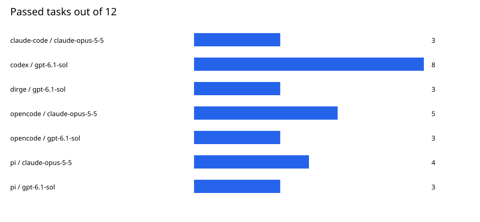
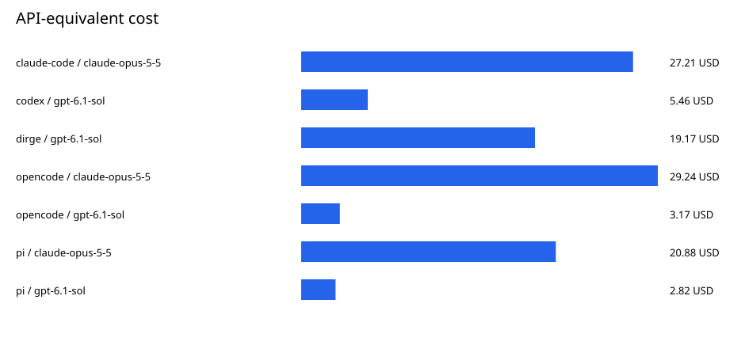
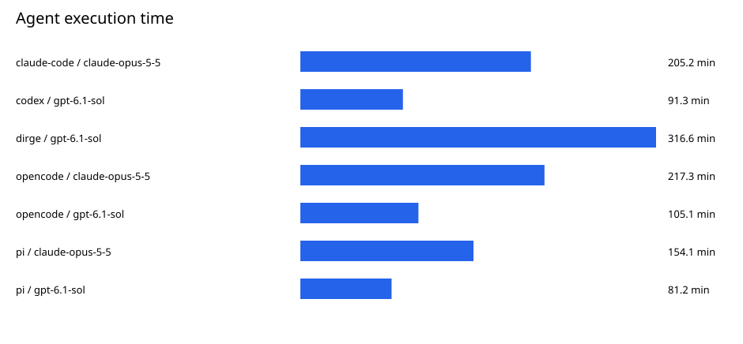

# Coding harness comparison

## Status and scope

This report contains 84 scored trials: 7 harness/model pairs across the same 12 tasks.
The r3 results are sealed. The new Opus runs used a dirty checkout and cannot pass the standard seal check.
Dirge uses the sealed 12-trial series when included. CA retries are separate, unsealed evidence and do not replace primary scores.
The SHA-256 manifest locks the available evidence and report bytes. It does not certify a clean historical checkout.
The source hashes describe the current generator and adapters, not a reconstructed historical checkout.

## Results

| Harness | Model | Version | Passed | Agent minutes | Median minutes | API-equivalent USD | USD per pass |
|---|---|---|---:|---:|---:|---:|---:|
| claude-code | claude-opus-5-5 | 2.1.302 | 3/12 | 205.2 | 4.3 | 27.21 | 9.07 |
| codex | gpt-6.1-sol | 0.163.0 | 8/12 | 91.3 | 4.9 | 5.46 | 0.68 |
| dirge | gpt-6.1-sol | dirge 0.25.7 | 3/12 | 316.6 | 7.0 | 19.17 | 6.39 |
| opencode | claude-opus-5-5 | 1.19.3 | 5/12 | 217.3 | 8.6 | 29.24 | 5.85 |
| opencode | gpt-6.1-sol | 1.19.3 | 3/12 | 105.1 | 5.9 | 3.17 | 1.06 |
| pi | claude-opus-5-5 | 1.3.0 | 4/12 | 154.1 | 5.3 | 20.88 | 5.22 |
| pi | gpt-6.1-sol | 1.3.0 | 3/12 | 81.2 | 3.1 | 2.82 | 0.94 |

## Task outcomes

Columns use the pair IDs listed below. PASS means reward 1; FAIL means reward 0.

- P1: claude-code / claude-opus-5-5
- P2: codex / gpt-6.1-sol
- P3: dirge / gpt-6.1-sol
- P4: opencode / claude-opus-5-5
- P5: opencode / gpt-6.1-sol
- P6: pi / claude-opus-5-5
- P7: pi / gpt-6.1-sol

| Task | P1 | P2 | P3 | P4 | P5 | P6 | P7 |
|---|---|---|---|---|---|---|---|
| bun-sourcemap-leak | FAIL | FAIL | FAIL* | FAIL | FAIL | FAIL | FAIL |
| html-js-filter | FAIL | PASS | PASS | FAIL | PASS | FAIL | FAIL |
| interleaved-vigenere | FAIL* | FAIL | PASS | PASS | FAIL | PASS | FAIL |
| kv-live-surgery | FAIL | PASS | FAIL | FAIL* | FAIL | FAIL | FAIL |
| music-harmony | FAIL | FAIL | FAIL | FAIL | FAIL | FAIL | FAIL |
| mvcc-lsm-compaction | FAIL | PASS | FAIL | FAIL | FAIL | FAIL | FAIL |
| payments-pipeline-fix | PASS | PASS | FAIL* | PASS | FAIL | PASS | PASS |
| photonic-waveguide-routing | PASS | PASS | PASS | PASS | PASS | PASS | PASS |
| react-lead-form | PASS | FAIL | FAIL* | PASS | FAIL | PASS | FAIL |
| session-window-debug | FAIL | PASS | FAIL* | FAIL | FAIL | FAIL | FAIL |
| vf2-speedup-networkx | FAIL | PASS | FAIL | PASS | FAIL* | FAIL | FAIL |
| wal-recovery-ordering | FAIL | PASS | FAIL | FAIL | PASS | FAIL | PASS |

## Exceptions and exclusions

An asterisk marks a recorded exception. These outcomes remain in the denominator.

- claude-code / claude-opus-5-5 / interleaved-vigenere: AgentSafetyRefusalError.
- dirge / gpt-6.1-sol / bun-sourcemap-leak: NonZeroAgentExitCodeError.
- dirge / gpt-6.1-sol / payments-pipeline-fix: AgentTimeoutError.
- dirge / gpt-6.1-sol / react-lead-form: NonZeroAgentExitCodeError.
- dirge / gpt-6.1-sol / session-window-debug: AgentTimeoutError.
- opencode / claude-opus-5-5 / kv-live-surgery: AgentSafetyRefusalError.
- opencode / gpt-6.1-sol / vf2-speedup-networkx: OpenCodeHangError.

Two new Opus OpenCode attempts failed before model execution because the runner omitted limit.context.
Their replacements are selected by task name, not by reward. The originals remain in the evidence manifest.
The earlier 32k Opus smoke is not part of this comparison. No result files were overwritten.

## Configuration and interpretation

All pairs use medium reasoning effort. New OpenCode Opus trials use a 128,000-token output cap and a 1,000,000-token context limit.
GPT and r3 Claude Code retain their recorded configurations. These are not identical output-budget comparisons.
Claude plugins: @gotgenes/pi-anthropic-auth@3.4.3 and @ex-machina/opencode-anthropic-auth@1.8.6.
Each task has a separate verifier container. Scoring checks artifacts and behavior, not the agent's completion claim.
Costs use the existing metrics implementation: reported agent cost when present, otherwise the pinned API price estimate.
Costs are API equivalents, not subscription invoices. Reported costs can use different provider accounting conventions.
Times cover agent execution, excluding setup and verification. Excluded attempts are not included in scored totals.
There is one trial per pair and task. Do not infer statistical superiority from these small differences.
OpenCode's r3 hang has unresolved transport-versus-harness attribution. Provider refusals are not environment failures.

## Reproduction

Run `python -m ctb.report` from the repository with its environment.
The generator verifies sealed r3 result hashes and each new reward file before rendering.
Outputs use sorted inputs, fixed SVG geometry and no clock, random IDs, external fonts or network requests.
SHA256SUMS covers data.json, REPORT.md and all three SVG files. manifest.json also records evidence hashes.
The artifact lock proves byte integrity, not that the trials can be rerun with identical model outputs.
